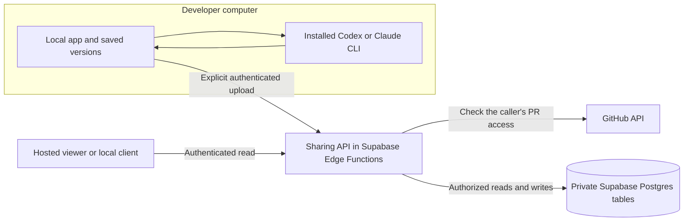

# Local generation and GitHub authorized sharing

Status: proposed implementation design. Updated October 31, 2026.

Keep walkthrough generation available on a developer's computer using their installed Codex or Claude CLI. Add a shared service that stores explicitly published walkthroughs and checks the reader's current GitHub access before returning them. A teammate can open a published walkthrough without installing a generator or keeping its author's computer online.

The proposed backend is Supabase Postgres with Supabase Edge Functions for authentication and the sharing API. A static hosted viewer provides shareable browser links. Keep the API and authorization logic portable so the existing Node server can provide the same contract when self-hosting. Supabase Auth is not required for the first implementation: retain GitHub App authentication and application sessions rather than introducing a second identity system.

## Product decisions

- Local generation, local saved history, and local chat remain usable without a sharing account, cloud database, or shared backend connection. Fetching uncached GitHub evidence and calling the selected model service still require their usual network connections.
- Generating saves locally by default. A separate **Share with repository** action publishes the selected version. The UI names the repository and explains that its eligible GitHub readers will be able to see the result. A future **Generate and share** shortcut must be an explicit choice.
- Shared access follows GitHub repository permissions and the GitHub App installation. Read access permits viewing; push or admin access permits publishing. There is no per-walkthrough invitation list. The optional operator login allowlist remains a deployment restriction, disabled by default for the shared service.
- Publication uploads the walkthrough's prose, excerpts, and pinned source references. It does not upload CLI credentials, model credentials, chat history, scratch edits, full repository archives, or arbitrary local files.
- A published version is immutable and attributed to its publisher. Publishing a changed result creates another version. Readers can distinguish local generation from a trusted hosted generation job.
- The first sharing release supports full-PR walkthroughs. Existing local `since` and `range` generation continues to work; publishing those scopes follows after the exact snapshot validation rules are implemented.

## Existing implementation

| Area | Current behavior | Planned change |
| --- | --- | --- |
| [Local runner](../app/src/local-runner.js) | Runs installed CLIs, validates excerpts against a complete local diff, and enriches the result with source references | Preserve generation; expose its saved result to a separate sharing client |
| [Local storage](../app/src/local-server.js) | Saves versioned JSON files under the user's application data directory | Preserve these files and add publication metadata separately |
| [Hosted authorization](../app/src/server.js) | Uses the reader's GitHub App user token to fetch the PR before serving stored content | Extract and reuse this policy for every sharing endpoint |
| [Hosted runs](../app/src/runs.js) | Combines generation jobs and results; deduplicates by PR commits, scope, generator version, harness, and model | Separate published versions from hosted jobs so multiple local results can coexist |
| [Worker](../app/src/worker.js) | Runs generation jobs and optionally posts a GitHub link | Remains an optional hosted capability; sharing a local result never queues generation |
| [Database migrations](../app/db/001_init.sql) | Assume a trusted application server connects directly to Postgres | Add a private sharing schema and explicit grants before hosting these tables on Supabase |

Changing `DATABASE_URL` to a cloud database does not implement this design. A distributed local app must receive neither a shared database password nor a Supabase secret key. Its local permission checks cannot protect a central database from someone who controls that computer.

## Architecture

Only the sharing backend holds database credentials, the GitHub App client secret and private key, and the key used to encrypt stored GitHub tokens. Local generation uses the developer's existing GitHub CLI and model credentials. The local sharing client holds a revocable session for that user and deployment; it never receives installation tokens or shared infrastructure credentials.

Use related production origins such as `https://walkthrough.example` for the viewer and `https://api.walkthrough.example` for the API. Browser sessions use secure, HttpOnly, host-only cookies on the API origin. Allow credentialed requests only from the exact viewer origin and validate Origin plus CSRF protection on browser mutations. The example domains are placeholders. Development origins must be explicitly configured.

The local Node process calls the remote API with a user bearer session. It keeps that session out of browser JavaScript and preserves its existing loopback host, Origin, and CSRF defenses. A web page must not be able to trigger an upload or invoke the local CLI through an unprotected localhost endpoint.

### Supabase boundary

Put application data in an unexposed schema such as `walkthrough_private`. Do not grant `anon` or `authenticated` direct access to its tables, views, or functions; keep these tables out of Realtime and public Storage. Revoke client access to legacy tables during migration as well, especially `sessions` and `runs`. Apply default privilege rules so future migrations do not accidentally expose new objects. Use a dedicated backend database role with only the grants it needs, and a pooled connection suitable for Edge Functions. Migration credentials stay separate.

RLS can provide an additional guard, with explicit policies for the backend role where needed. GitHub authorization remains in the API; RLS does not automatically know GitHub membership. No client-facing RPC or alternate Data API route may bypass that check. Supabase distinguishes [table grants from row policies](https://supabase.com/docs/guides/api/securing-your-api), and its [secret keys bypass RLS](https://supabase.com/docs/guides/getting-started/api-keys).

The first version uses opaque application sessions rather than Supabase JWTs. Configure the relevant Edge routes to accept that credential format and validate it inside shared middleware before protected work. Disabling a platform JWT check is not authentication. Public OAuth, device-pairing, and signed webhook routes must have explicit handlers and validation. Confirm this configuration in the deployment spike against [Supabase's function authentication model](https://supabase.com/docs/guides/functions/auth).

## Authentication and access

### Hosted sign in

1. Send the browser through the existing GitHub App authorization flow, adding single-use, expiring state and PKCE handling.
2. Exchange the authorization code on the backend. Derive the numeric GitHub user ID from GitHub, never from a submitted login or profile field.
3. Store the GitHub user and refresh tokens encrypted in a private connection record. Store only a hash of the application session token. Give sessions explicit expiry and revocation fields.
4. Serialize refreshes for a connection so simultaneous requests do not race token rotation. Clear invalid connections and require sign-in again when refresh or authorization fails.

Keep GitHub user identity separate from the browser and CLI sessions that reference it. GitHub App user tokens restrict access to the intersection of the user's and the app's permissions; an installation token alone cannot establish a reader's access. See [GitHub user access tokens](https://docs.github.com/en/apps/creating-github-apps/authenticating-with-a-github-app/generating-a-user-access-token-for-a-github-app).

### Local client sign in

Add a browser-assisted pairing flow for the local sharing client. This is an application pairing protocol, not a claim that the local client can use the GitHub App secret.

1. The client creates a random verifier and requests a pairing session with its challenge. The API returns a short-lived device code, a human-readable verification code, a fixed hosted verification URL, and a polling interval.
2. The user opens that hosted page, signs in with GitHub, and confirms the displayed code and local-client connection. Merely opening the page does not approve a pairing.
3. The client polls with the device code and proves possession of the verifier before receiving its application session. Codes are single-use, expire after ten minutes, and are rate-limited. No credential appears in a redirect URL.
4. Store the user session in the OS credential store. If unavailable, use an explicitly documented owner-readable credentials file outside the repository. Default to a 15-minute access token and a rotating refresh token with a 30-day maximum lifetime. Refresh consumes the previous token atomically; detected reuse revokes that device's token family. Logout revokes that device session. Tokens are scoped to the configured service origin.

The API stores hashes of pairing codes and application tokens. Pairing approval requires a valid browser session and CSRF protection. It returns only an application session, never the stored GitHub token. The local GitHub CLI account and sharing account may differ; show the publishing identity, and authorize using the sharing account.

### Authorization on every request

For a walkthrough ID, first resolve only the private record metadata needed to identify its repository and PR. Fetch that PR with the caller's GitHub user token and verify the stable numeric repository ID matches the stored record before returning any content or metadata to the caller. Resolve current repository names from GitHub so renames work without permitting name-reuse attacks.

Apply the same gate to version lists, downloads, source-code reads, review marks, and any future search, chat, or export endpoint. Inbox repository IDs come from the intersection of GitHub App installations and the caller's accessible repositories. UUIDs and possession of a share URL do not confer access.

- Viewing requires successful live read access. Publishing additionally requires push or admin permission and an active app installation covering the repository.
- Removing a published version requires current repository admin permission, or both publisher identity and current push permission. This affects publication management, not who can read other versions.
- Return a uniform not-found response for absent and inaccessible records. Treat expired login as unauthorized and transient GitHub failures as unavailable. A GitHub outage must not become a cached authorization success or a deletion signal.
- Do not cache successful authorization across requests in the initial release. Cache immutable content only behind the gate; set authenticated responses to `Cache-Control: no-store` and avoid public CDN response caching.
- Permission removal blocks subsequent online reads once GitHub reflects the change. Previously downloaded or locally generated content cannot be recalled from a user's computer.

## Generation and publication flow

1. **Generate locally.** Keep the existing `open` and `serve` commands and their local saved history. No sharing service request is needed to generate or save a result. Model calls use the local CLI account; local execution does not imply that the model itself runs offline.
2. **Choose Share with repository.** Show the selected version, repository, publishing identity, and audience. Sign in to sharing if needed. Local history remains intact if sign-in, validation, or upload fails.
3. **Obtain a publish context.** The API checks current permissions and registers the PR's base SHA, head SHA, merge base, and changed-file metadata from GitHub as a snapshot. Recheck the PR pair after fetching file metadata so a concurrent push cannot mix versions.
4. **Match the local result.** Its commits must match that snapshot or a previously registered snapshot for the same PR. An unrecognized historical pair cannot be published in the first release; keep it local and explain that the user can generate the current version. Do not require cloud registration before ordinary local generation.
5. **Upload once.** Send the saved result, the snapshot ID, reported harness/model, and a persisted idempotency key. The backend repeats authorization, validates the payload, and commits an immutable published version atomically.
6. **Record the shared link.** Save the service origin, published ID, and returned URL alongside local publication metadata. A timeout is retried with the same key; it must not create another version or trigger a model call.
7. **Discover and read.** The version appears in the authorized repository's shared PR history. Teammates can open its exact version link, or find the latest current full-PR version in the hosted inbox. A successful publish requires no separate invitation or approval from each teammate.

Use `/p/{owner}/{repo}/{number}/v/{id}?tab=walkthrough` for a pinned link and `/p/{owner}/{repo}/{number}?tab=walkthrough` for the current full-PR version. If the PR has changed, the old result remains in history with its archived label. It must not silently become the current walkthrough. Choose the latest publication matching the current base/head pair, with deterministic timestamp and ID ordering.

Posting a discovery comment on GitHub remains separate and opt-in. Publish success does not depend on comment success; a failed comment can be retried without re-uploading. Post only links to a teammate-accessible HTTPS viewer, and preserve the existing single-comment update behavior.

## Upload validation and provenance

Treat a local upload as content contributed by an authenticated repository writer. The server can validate its structure and repository binding, but a client assertion cannot prove which model ran, whether the client executed the validator, or whether the explanation is correct.

The first release will:

- Accept only a versioned JSON envelope, capped at 2 MiB before parsing. Preserve the current bounds of 200 changed files, 30 slices, and 8 beats per slice; add bounded strings and equivalent bounds for the anchor and every nested collection. Unsupported schema versions fail explicitly.
- Require a backend-issued snapshot for the target PR. Derive repository ID, installation, publisher, publication time, visibility, and authoritative base/head/source-path metadata on the server. Never accept these as security decisions from the payload.
- Reject result files and source links outside the snapshot's changed-file set. Bind all source retrieval to its stored repository, commits, and normalized paths. Enrich code locations from trusted evidence where available; do not describe client-supplied line numbers as server-verified.
- Preserve local exact-excerpt validation against the complete diff. Record remote validation as `structure_and_snapshot`, not `complete_diff_verified`. GitHub patch responses can be incomplete; do not use them as proof of a complete snapshot diff.
- Render all prose, diagrams, links, and filenames through the existing safe rendering path. Add malicious-upload fixtures before enabling publication.
- Display **Generated locally and shared by @user**. Store the harness and model as client-reported provenance. Hosted generation can use a separate trusted-job provenance value.

A later container worker may independently reproduce the pinned diff and validate excerpts without rerunning generation. That is optional and must expose a separate validation status. Do not attempt repository archive extraction, Git subprocesses, or CLI generation inside the short sharing request. Supabase Edge Functions have [runtime and resource limits](https://supabase.com/docs/guides/functions/limits).

Private-model allowlists can govern managed hosted generation, but cannot attest to a model used on someone else's machine. Locally submitted model names must not be treated as evidence that such a policy was enforced.

## Data model

Use separate published artifacts so an uploaded walkthrough cannot accidentally be claimed by the existing generation worker.

| Record | Relevant fields and constraints |
| --- | --- |
| `github_connections` | Numeric GitHub user ID, encrypted provider tokens, expiry, revocation, and token refresh coordination |
| `app_sessions` | Token hash, connection ID, browser or local-client kind, expiry, revocation, and refresh-family metadata |
| `device_pairings` | Hashed device and verification codes, verifier challenge, expiry, polling state, approved user, and consumption time |
| `pr_snapshots` | UUID, repository ID, PR number, base/head/merge-base SHAs, scope boundaries, source-file manifest, and capture time; immutable after registration |
| `walkthrough_versions` | Server UUID, snapshot ID, schema version, result JSONB, reported harness/model, origin, validation level, publisher ID, reported generation time, server publication time, and payload digest |
| `publication_requests` | Publisher ID plus idempotency key, canonical request digest, resulting version ID, and completion state; unique publisher/key pair |
| Existing `pulls` and `installations` | GitHub identity and current PR metadata, with deletion relationships covering new snapshots and versions |
| Existing `review_marks` | Per-user completed-review state; independent of shared content and scoped to the authenticated user |

Do not apply the existing `runs_model_version` uniqueness constraint to `walkthrough_versions`. Two developers may produce different valid results for the same commits and model. Repeating the same idempotency key and digest returns the original version; changing its payload returns conflict. Identical content with another key may remain a distinct attributed publication. Store idempotency outcomes transactionally and retain them for the published artifact's lifetime; withdrawn versions retain a small request tombstone so retries cannot republish them.

Keep the generation-job `runs` table for hosted deployments. Backfill ready hosted results into published versions while preserving their UUIDs and existing version URLs. Mark migrated results `legacy`, retaining their historical validation semantics and stored scope, even when an old snapshot can no longer be fetched. Keep unknown historical publisher IDs nullable rather than inventing attribution. Future hosted jobs publish through the same storage service after trusted job completion. Read routing must continue to handle queued/failed jobs, and workers must never select local publications as jobs.

Use additive migrations and an idempotent backfill with a recorded old-run-to-version mapping. Preserve legacy tables and results through the cutover. Require fresh sign-in for the new session system instead of importing ambiguous per-session GitHub refresh tokens. Rollback stops new publication and restores the previous Node read path without dropping new artifact tables; a forward migration can resume their use. Test the backfill against full, scoped, failed, and in-flight legacy runs.

Existing local JSON files are never bulk-uploaded by a migration. A local metadata sidecar maps a local version ID to one or more service origins and published IDs, without rewriting its generation result. Treat browser navigation progress and chat history as private local state.

## API contract

All routes below are proposed. Protected routes share the same session and GitHub authorization middleware; the two pairing initiation/polling routes have their own code, verifier, expiry, and rate-limit checks.

| Endpoint | Behavior |
| --- | --- |
| `GET /auth/login` and `GET /auth/callback` | GitHub App sign-in and server-side code exchange |
| `POST /auth/device` | Start local-client pairing; return codes and a fixed verification URL |
| `GET /auth/device/verify` and `POST /auth/device/approve` | Show and explicitly approve a code using a signed-in browser |
| `POST /auth/device/token` | Poll and consume an approved pairing with verifier proof |
| `POST /auth/refresh` and `POST /auth/logout` | Rotate or revoke the current application session |
| `GET /v1/me` | Return the authenticated GitHub identity |
| `GET /v1/pulls` | List synced PRs and published availability only for currently accessible repositories |
| `POST /v1/pulls/{owner}/{repo}/{number}/publish-context` | Authorize a publisher and register or return a consistent PR snapshot |
| `POST /v1/pulls/{owner}/{repo}/{number}/walkthroughs` | Publish a bounded payload using `Idempotency-Key`; return ID, pinned URL, and provenance |
| `GET /v1/pulls/{owner}/{repo}/{number}/walkthroughs` | Return authorized version summaries, with pagination |
| `GET /v1/walkthroughs/{id}` | Return an authorized immutable result |
| `GET /v1/walkthroughs/{id}/code` | Fetch an allowed file/side at the stored snapshot using the reader's GitHub token |
| `DELETE /v1/walkthroughs/{id}` | Withdraw a publication under the management rule above; preserve the local original |

Use unauthorized for expired sessions, not-found for inaccessible resources, conflict for snapshot/idempotency mismatches, payload-too-large for oversized input, validation errors for malformed content, rate-limited for exhausted quotas, and unavailable for transient upstream errors. Responses must not include raw GitHub responses containing credentials or private diagnostic context.

Limit uploads per user and repository and pairing requests per client address. Start with the existing repository limit of 20 new versions per day as a configurable shared-publication default, separate from hosted model-spend accounting. An idempotent retry does not consume another slot. Enforce quotas and uniqueness in database transactions rather than Edge process memory.

## Runtime and deployment choices

| Option | Decision |
| --- | --- |
| Supabase Postgres plus Edge sharing API, static viewer | Proposed shared-service default. Keeps local model execution independent and centralizes secret handling and GitHub checks |
| Existing Node server plus managed Postgres | Supported adapter and lowest-change self-hosted path. Can retain the full existing hosted review workspace and optional worker |
| Vercel API functions plus Postgres | Can implement the same API. Hosted CLI generation still needs an appropriate job runtime rather than the current infinite worker loop in a request handler |
| Direct client access with Supabase RLS | Deferred. Requires a trusted process to maintain repository permission grants and a defined revocation delay; live API checks are simpler for the initial design |
| Supabase Compute | Do not depend on it for the first production release. It is currently a [private alpha for evaluation](https://supabase.com/blog/supabase-compute-private-alpha) |

The hosted sharing viewer initially supports inbox, history, walkthrough reading, and pinned source access. It does not require a cloud model key or silently move chat to a cloud provider. The existing full hosted application remains available through the Node adapter; porting every GitHub action and hosted chat flow to Edge Functions is outside the first sharing release.

For a Supabase deployment, extract browser-compatible rendering assets from the current server-rendered pages and keep secrets out of static builds. Validate custom domains, OAuth callbacks, same-site cookie behavior, CORS, pooled database connections, and dependency compatibility in a small deployment spike before the full API port. Edge handlers must not import the local runner or modules that launch subprocesses.

## Lifecycle and operations

- Signed GitHub webhooks handle installation removal, repository removal, and GitHub App authorization revocation. Uninstall/repository removal purges the associated live hosted content; suspension makes it unavailable without treating a temporary suspension as permanent deletion. App authorization revocation invalidates that user's connection and dependent application sessions. Live access checks remain mandatory.
- A scheduled reconciliation job repairs missed webhook state. Delete only after an authoritative removal event or confirmed removal, never because an API request timed out. This job synchronizes metadata and lifecycle state without generating walkthroughs.
- Log request IDs, action types, outcome codes, and timing. Keep tokens, uploaded prose, code excerpts, and model prompts out of logs. Audit publication and withdrawal by stable user and repository IDs.
- Back up hosted Postgres and test restore. Document retention of database backups separately from removal of live data. Local copies remain under each developer's control.
- Rotate backend database and GitHub App secrets independently of user sessions. Never pass sharing sessions, database credentials, or new service secrets to model subprocesses; extend the current runner environment filtering or replace it with an explicit environment allowlist.
- If sharing is unavailable, generation still saves locally and publication can be retried. Once publication succeeds, reading it does not depend on the author's laptop or model account.

## Implementation sequence

### Phase 1 Contracts and runtime spike

Extract pure result schema/validation, snapshot identities, GitHub authorization, and artifact repository interfaces from the existing modules. Keep filesystem, subprocess, HTTP-server, and database adapters separate. Deploy one authenticated read handler against a private test schema, proving the custom session middleware, cookie flow, and database pooler work on Supabase. Keep the Node adapter as the fallback if Edge compatibility requires excessive changes.

Completion: an authorized account can read a fixture through the API, an unrelated account and direct Data API request cannot, and the existing local commands still run without shared-service configuration.

### Phase 2 Authentication and private storage

Implement GitHub connection/session storage, local-client pairing and credential storage, explicit database grants, immutable snapshots, published versions, and atomic idempotency/quota handling. Add installation lifecycle processing and migrations that preserve existing hosted version links. Run this stage against a disposable database before migrating a shared deployment.

Completion: read and write permissions are enforced server-side, replayed pairing codes fail, concurrent token refresh is safe, and rollback to the existing Node deployment remains possible without deleting new publications.

### Phase 3 Local publication

Add a sharing client module, local UI share action, publication sidecars, and proposed CLI commands `pr-walkthrough login --service <origin>`, `pr-walkthrough share <local-version-id>`, and `pr-walkthrough logout`. Service choice is explicit and stored with credentials so a workspace file cannot redirect a token to another host. Preserve local-only operation and keep upload retries independent from generation.

Completion: generate once with an installed CLI, publish the saved result, retry a simulated lost response, and observe exactly one shared version with no additional model call.

### Phase 4 Hosted discovery and reading

Build the minimal hosted viewer, authorized inbox, version history, pinned source access, publisher attribution, and optional GitHub link publication. Switch the Node adapter's ready-result reads to the artifact repository while preserving pending-job views. Ensure every source, result, and version-list route uses the same access policy.

Completion: a teammate with read access can open the shared link while the generator's computer is offline; a nonmember cannot; revoking access blocks the next online request.

### Phase 5 Additional review scopes and optional hosted execution

Extend snapshot registration and sharing to `since` and `range`, validating exact start/end snapshots without substituting a merge-base comparison. Preserve local review baselines and handle force-pushed commits explicitly. Integrate optional hosted generation with the same artifact publication service and consider independent diff verification as a separate job.

Completion: scoped results retain their exact boundaries and provenance, stay distinct from the current full-PR walkthrough, and neither sharing nor reading requires hosted model execution.

## Acceptance checks

| Scenario | Required result |
| --- | --- |
| No cloud credentials or shared backend | Existing local generation, saved history, and local chat remain available with their normal GitHub/model dependencies |
| Cloud sharing outage during or after generation | Local result is saved; retrying publication never reruns the model |
| Read-only GitHub teammate | Can view a shared full-PR walkthrough; cannot publish or change another version |
| Unrelated signed-in GitHub user or guessed UUID | Cannot read result, history, source, or private metadata |
| Removed repository permission or revoked app authorization | Next protected online request is denied once GitHub reflects the change |
| GitHub transient failure | No stored result is disclosed through a cached allow decision; no purge occurs |
| Changed repo name or reused old name | Stable repository ID prevents a version being served for a different repository |
| Direct Supabase REST, GraphQL, RPC, or Realtime access | No protected content or session data is accessible to client roles |
| Forged repo ID, publisher, scope, source path, or provenance | Rejected or replaced with authoritative server values |
| Malformed, oversized, or executable-looking upload | Rejected by bounds or rendered inert; no file execution or credential exposure |
| Lost upload response and concurrent retry | One immutable version; changed payload with the same key produces conflict |
| Two writers generate the same commits/model differently | Separate attributed versions; neither overwrites the other |
| PR changes during generation or snapshot registration | Snapshot capture retries or upload uses an already registered historical snapshot; no mixed/current mislabeling |
| Author's laptop is offline after publication | Authorized teammates can read all stored slices and fetch pinned source from GitHub |
| Pairing replay, wrong verifier, unapproved code, or expired code | No local-client session issued |
| Reader progress, chat, and local scratch edits | Not included in the shared artifact |
| Database migration and rollback | Existing pinned hosted URLs keep resolving; local files and new publications are preserved |

Automate the authorization, idempotency, schema, lifecycle, and migration cases with disposable database fixtures. Add browser coverage for sign-in, pairing, explicit sharing, and teammate reading. Before release, exercise two real GitHub identities with different permissions against a test repository and verify the deployed Supabase exposure rules. These checks belong to implementation; this design does not enable cloud sharing by itself.
